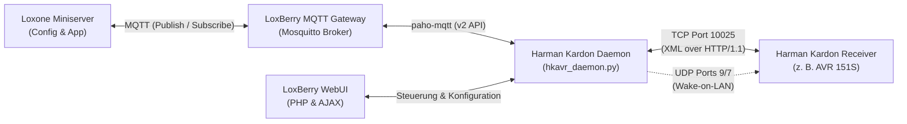

<div align="center">

# 🎛️ LoxBerry Plugin: Harman Kardon AVR

[](https://wiki.loxberry.de/)
[](https://www.python.org/)
[](https://mqtt.org/)
[](#)
[](LICENSE)

**Intelligente Heimkino-Steuerung für Harman Kardon AV-Receiver über lokales Netzwerk (Port 10025) und MQTT für den Loxone Miniserver.**

[Funktionen](#-funktionen) • [Architektur](#-architektur) • [Unterstützte Geräte](#-unterstützte-geräte) • [MQTT Topics](#-mqtt-topics) • [Loxone Einbindung](#-loxone-miniserver-integration) • [Heimkino-Setup](#-heimkino-synergie-panasonic-tv--harman-kardon-avr) • [Installation](#-installation)

---

</div>

## 📖 Überblick

Dieses Plugin bindet netzwerkfähige **Harman Kardon AV-Receiver** (z. B. **AVR 151S**, **AVR 161S**, **AVR 171**, **AVR 370** und die **BDS-Serie**) nahtlos in dein Loxone Smart Home ein.

Das Plugin kommuniziert über das native Harman Kardon Socket-Protokoll (TCP Port 10025) direkt mit dem Receiver und synchronisiert alle Zustände und Steuerbefehle in Echtzeit mit dem integrierten **LoxBerry MQTT Gateway**. Zusammen mit dem [LoxBerry-Plugin-PanasonicTV](https://github.com/challo2018/LoxBerry-Plugin-PanasonicTV) entsteht so ein vollständig automatisiertes Heimkino-Erlebnis.

---

## ✨ Funktionen

* 🔄 **Bidirektionale MQTT-Anbindung:**
  * Automatische Integration in das **LoxBerry MQTT Gateway** (oder externe Broker).
  * Veröffentlicht Power-Status, Lautstärke, Stummschaltung, Eingangsquelle und Online-Status.
  * Verarbeitet Steuerbefehle verzögerungsfrei über MQTT Topics (`harmankardon/set/*`).
  * Last-Will-and-Testament (LWT) zur sofortigen Erkennung des Daemon-Zustands (`online`/`offline`).
* ⚡ **Wake-on-LAN (WOL):**
  * Zuverlässiges Aufwecken aus dem Standby/Eco-Modus über Magic Packets via LAN.
  * Automatisches Aufwecken beim Empfang eines Power-ON-Befehls.
* 💓 **Aktives Netzwerk-Keepalive (Heartbeat):**
  * Löst das bekannte Verhalten älterer Harman Kardon Firmware, die im Leerlauf die Netzwerkkarte in den Tiefschlaf versetzt.
  * Regelmäßige konfigurierbare `heart-alive`-Pings halten den Netzwerk-Stack dauerhaft ansprechbar.
* 🎛️ **Vollständige Befehlsunterstützung:**
  * **Power:** `ON`, `OFF`, `TOGGLE`, `SLEEP`
  * **Lautstärke:** Schrittweise (`UP`, `DOWN`, `+5`, `-5`) oder direkt absolut (`0`–`100`).
  * **Stummschaltung:** `toggle`, `true` (Mute an), `false` (Mute aus).
  * **Quellenwahl:** `TV`, `Game`, `Radio`, `Disc`, `AUX`, `Cable Sat`, `DVR`, `Media Server`, etc.
  * **D-Pad & Menü:** `up`, `down`, `left`, `right`, `ok`, `back`, `home`, `options`, `info`.
  * **Mediensteuerung:** `play`, `pause`, `previous`, `next`, `forward`, `reverse`.
  * **Multi-Zone:** Steuerung von `Main Zone` und `Zone 2`.
* 🎮 **Modernes Webfrontend im LoxBerry Design System:**
  * Responsive Oberfläche (ohne jQuery Mobile) mit Live-Fernbedienung.
  * Status-Badges für Online-Status, Power, Quelle und Lautstärke.
  * Automatische Erkennung der IP und MAC-Adresse (ARP / Subnetz-Scan).
  * Interaktive Dokumentation der MQTT-Befehle mit Test-Buttons direkt im Browser.
  * Live-Logdatei-Viewer mit Auto-Scroll und Diagnosewerkzeugen.

---

## 🏛️ Architektur



---

## 📺 Unterstützte Geräte

Das Plugin unterstützt alle netzwerkfähigen Harman Kardon AV-Receiver und BDS Heimkino-Systeme:

| Modell-Reihe | Getestete Geräte | Protokoll-Typ |
|---|---|---|
| **AVR Serie** | **AVR 151S**, AVR 151, **AVR 161S**, AVR 161, **AVR 171S**, AVR 171, AVR 170, AVR 370, AVR 3700 | `AVR` |
| **BDS Serie** | BDS 277, BDS 375, BDS 577, BDS 7773w | `BDS` |

---

## 📡 MQTT Topics

Standardmäßig lautet das Präfix `harmankardon` (konfigurierbar).

### 📤 Status (vom Plugin an MQTT gesendet)

| Topic | Typ / Werte | Beschreibung |
|---|---|---|
| `harmankardon/status/online` | `true` / `false` | Receiver im Netzwerk erreichbar |
| `harmankardon/status/power` | `ON` / `OFF` / `STANDBY` | Aktueller Einschaltzustand |
| `harmankardon/status/volume` | `0` – `100` | Lautstärkelevel (Schätzung) |
| `harmankardon/status/mute` | `true` / `false` | Stummschaltung aktiv |
| `harmankardon/status/source` | Text (z. B. `TV`, `Game`) | Aktive Eingangsquelle |
| `harmankardon/status/zone` | `Main Zone` / `Zone 2` | Aktive Zone |
| `harmankardon/status/daemon` | `online` / `offline` | Zustand des Hintergrunddienstes (MQTT LWT) |
| `harmankardon/status/json` | JSON Object | Kompletter Zustand für den Loxone JSON-Parser |

### 📥 Befehle (an das Plugin gesendet)

| Topic | Werte / Payloads | Funktion |
|---|---|---|
| `harmankardon/set/power` | `ON`, `OFF`, `TOGGLE`, `SLEEP` | Einschalten (inkl. Auto-WOL falls im Standby), Ausschalten oder Sleep |
| `harmankardon/set/volume` | `UP`, `DOWN`, `+5`, `-5`, `0-100` | Lautstärke stufenweise oder absolut anpassen |
| `harmankardon/set/mute` | `toggle`, `true`, `false`, `1`, `0` | Stummschaltung umschalten oder gezielt setzen |
| `harmankardon/set/source` | `TV`, `Game`, `Radio`, `Disc`, `AUX`, etc. | Eingangsquelle umschalten |
| `harmankardon/set/key` | `up`, `down`, `left`, `right`, `ok`, `back`, `home`, `options`, `info`, `play`, `pause`, etc. | Fernbedienungstaste simulieren |
| `harmankardon/set/wol` | `1` | Sendet Wake-on-LAN Magic Packet |
| `harmankardon/set/zone` | `Main Zone`, `Zone 2` | Zielzone für Befehle wechseln |
| `harmankardon/set/heartbeat` | `1` | Sendet manuellen Keepalive-Ping (`heart-alive`) |

---

## 🏠 Loxone Miniserver Integration

### 1. Status im Miniserver empfangen (Virtuelle Eingänge)

1. Im LoxBerry das **MQTT Gateway** aktivieren.
2. In der **Loxone Config** Virtuelle Eingänge anlegen:
   * **Power-Status:**
     * Typ: Virtueller Texteingang
     * Name: `AVR Power`
     * Verbindung / Topic: `harmankardon/status/power`
   * **Aktive Quelle:**
     * Typ: Virtueller Texteingang
     * Name: `AVR Quelle`
     * Verbindung / Topic: `harmankardon/status/source`
   * **Lautstärke:**
     * Typ: Virtueller analoger Eingang
     * Name: `AVR Lautstaerke`
     * Verbindung / Topic: `harmankardon/status/volume`
   * **Stummschaltung:**
     * Typ: Virtueller digitaler Eingang
     * Name: `AVR Mute`
     * Verbindung / Topic: `harmankardon/status/mute`

### 2. Befehle senden (Virtuelle Ausgänge)

1. In der Loxone Config einen **Virtuellen Ausgang** für MQTT anlegen:
   * **Adresse:** `http://127.0.0.1:1883` (bzw. IP deines LoxBerry)
2. **Virtuelle Ausgangsbefehle** für die gewünschten Aktionen anlegen:
   * **Power Toggle:**
     * Topic: `harmankardon/set/power`
     * Befehl bei EIN: `TOGGLE`
   * **Quelle TV (Heimkino):**
     * Topic: `harmankardon/set/source`
     * Befehl bei EIN: `TV`
   * **Lauter (+5):**
     * Topic: `harmankardon/set/volume`
     * Befehl bei EIN: `+5`
   * **Leiser (-5):**
     * Topic: `harmankardon/set/volume`
     * Befehl bei EIN: `-5`
   * **Stumm umschalten:**
     * Topic: `harmankardon/set/mute`
     * Befehl bei EIN: `toggle`

---

## 🎬 Heimkino-Synergie: Panasonic TV + Harman Kardon AVR

In Kombination mit dem [LoxBerry-Plugin-PanasonicTV](https://github.com/challo2018/LoxBerry-Plugin-PanasonicTV) lässt sich eine perfekte One-Click-Heimkino-Szene in Loxone realisieren:

```
Szene: "Heimkino Starten"
  ├── 1. panasonictv/set/power: ON                  (TV einschalten)
  ├── 2. harmankardon/set/power: ON                 (Harman Kardon AVR einschalten & WOL senden)
  ├── 3. harmankardon/set/source: TV                (AVR Eingang auf TV stellen)
  └── 4. panasonictv/set/audio_output: home_theater (VIERA Link Makro schaltet Audio auf externen AVR um)
```

> [!TIP]
> **Audioausgabe-Umschaltung:** Viele Smart-TVs schalten beim Start unerwünscht auf die internen Lautsprecher zurück. Durch das Zusammenspiel beider Plugins wird der TV-Ton vollautomatisch auf das Harman Kardon 5.1-System gelegt!

---

## 💡 Praxistipps für den AVR 151S

* **Wake-on-LAN einrichten:**  
  Der AVR 151S schaltet im Standby nach einiger Zeit seinen internen Netzwerkport stromsparend ab. Trage in der WebUI des Plugins unbedingt die **MAC-Adresse** deines Receivers ein (oder nutze die Schaltfläche **Auto-Detect**). Das Plugin sendet dann vor dem Einschalten automatisch ein Magic Packet.
* **Keepalive aktivieren:**  
  Lasse die Option **Netzwerk-Keepalive (Heartbeat)** aktiviert (Standard: 60 Sekunden). Dadurch bleibt der Netzwerk-Stack des AVR 151S permanent aktiv und erreichbar.
* **Feste IP-Adresse:**  
  Vergib deinem AVR im Router eine feste IP-Adresse bzw. eine DHCP-Reservierung.

---

## 📦 Installation

1. Lade das fertige Archiv [`LoxBerry-Plugin-HarmanKardonAVR.zip`](https://github.com/challo2018/LoxBerry-Plugin-HarmanKardonAVR/archive/main.zip) herunter.
2. Öffne die **LoxBerry Plugin-Verwaltung** im Browser.
3. Wähle die ZIP-Datei aus und starte die Installation.
4. Nach Abschluss öffne die Plugin-Einstellungen:
   * Trage die **IP-Adresse** deines Receivers ein (oder klicke auf `🔍 Suchen`).
   * Klicke auf **Auto-Detect** zur Ermittlung der MAC-Adresse für Wake-on-LAN.
   * Speichere die Konfiguration.

---

## 🛠️ Entwicklung & Struktur

```
LoxBerry-Plugin-HarmanKardonAVR/
├── bin/
│   ├── hkavr_control.py      # Standalone CLI & Socket-Client (Port 10025, WOL, ARP)
│   └── hkavr_daemon.py       # 2-Wege MQTT Hintergrunddienst (paho-mqtt v2)
├── config/
│   └── harmankardon.json     # Standardkonfiguration
├── cron/
│   └── cron.10min            # Watchdog zur automatischen Überwachung
├── daemon/
│   ├── daemon.sh             # Start/Stop/Status-Steuerung
│   └── harmankardon          # Daemon-Starter für LoxBerry
├── icons/                    # Plugin-Icons (64, 128, 256, 512px)
├── templates/lang/           # Deutsche & Englische Lokalisierung
├── webfrontend/htmlauth/
│   ├── index.php             # Responsive WebUI (LoxBerry Design System)
│   └── ajax.php              # AJAX-Handler für UI-Aktionen
├── plugin.cfg                # LoxBerry Plugin-Metadaten (v1.0.0)
└── postinstall.sh            # Automatische venv- & Rechte-Einrichtung
```

---

## 📄 Lizenz

Dieses Projekt ist unter der **MIT-Lizenz** lizenziert – siehe die [LICENSE](LICENSE) Datei für Details.

*Hinweis: Harman Kardon ist ein eingetragenes Warenzeichen der Harman International Industries. Dieses Projekt steht in keiner offiziellen Verbindung zu Harman Kardon.*
